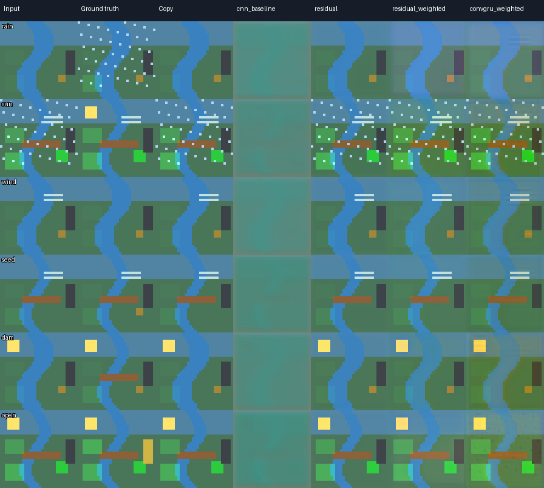

# EchoWorld: Interactive World Models for AI-Native Gameplay

**From structured state prediction to action-conditioned visual dynamics.**

[Research & product case study](docs/RESEARCH.md) · [v1 source](src/) · [v2 experiments](experiments/v2/) · [v3 experiments](experiments/v3/) · [Genie research](#research-foundations)

> **Status — Research prototype, not a Genie 4 implementation.** EchoWorld trains small PyTorch models on synthetic trajectories from a deterministic exploration game. The current visual experiments are preliminary (v3: 20 training episodes, 2 epochs). The project does not access Google's Genie 4 weights or API, nor demonstrate photorealistic real-time world generation.

## The product question

**Can AI-driven world dynamics make players' environmental experiments persistent, causally coherent, and meaningfully different from a fixed-action game?**

EchoWorld is a small exploration-game testbed set on an island with a damaged ecosystem. A player can manipulate rain, sunshine, wind, planting, a dam, and a gate. Changes affect moisture, vegetation, water management, and progression toward restoring a tower.

The proposed **AI-native** extension lets players articulate open-ended interventions, observe consequences, and iterate on their hypotheses. In that design, AI is not merely an asset generator: it expands the set of meaningful world interventions. This value proposition is **not yet validated** by the existing fixed-action prototype.

### Hypothesized core loop

`Explore → Form a hypothesis → Intervene → Observe persistent consequences → Revise strategy`

**Design invariant:** a generative system may propose or render plausible changes, but game-critical facts (object identity, resource constraints, reachability, quest completion) require an independently verifiable world state.

## Research evolution

| Stage | Question | Technical contribution | What the experiments revealed |
|---|---|---|---|
| **[v1 — Structured dynamics](src/)** | Can a model learn action-conditioned game-state transitions? | Synthetic `(state, action, next_state)` dataset; PyTorch MLP; rule-engine comparison | High normal-test accuracy, but greater numerical error on a critical gameplay path. |
| **[v2 — Reliability & visual prediction](experiments/v2/)** | Does the learned world remain reliable after repeated steps, boundary states and pixel prediction? | 10/50-step autoregressive state tests; boundary tests; 32×32 action-conditioned CNN | Out-of-distribution boundary error was high; first visual CNN was worse than frame copying. |
| **[v3 — Change-aware temporal modeling](experiments/v3/)** | Can residual learning, change weighting and short-term memory improve visual changes without damaging static scenery? | Residual CNN; changed-pixel-weighted loss; change-rich sampling; four-frame ConvGRU; region-based object appearance proxy; controlled ablation | Residual model slightly beat frame copying on total MSE; ConvGRU+weighting gave lowest changed-pixel MSE but worse global MSE in this small run. |

### Selected quantitative findings

**v1 — Structured-state evaluation**

| Measure | Result |
|---|---:|
| Independent test: Boolean-state accuracy | 99.97% |
| Independent test: moisture/ecosystem MAE | 1.197 percentage points |
| Critical-path moisture/ecosystem MAE | 3.57 percentage points |
| No-change baseline: moisture/ecosystem MAE | 5.133 percentage points |

**v2 — Rollouts & first visual baseline**

| Measure | Result |
|---|---:|
| 10-step endpoint numerical MAE (100 episodes) | 3.556 pp |
| 50-step endpoint numerical MAE (100 episodes) | 1.13 pp |
| Boundary-state numerical MAE (2,136 combinations) | 21.77 pp |
| Visual CNN test MSE | 0.01585 |
| Copy-previous-frame test MSE | 0.00341 |

The 50-step endpoint error being lower than the 10-step endpoint error **does not prove improved long-term forecasting**: absorbing/saturated states and differing sampled trajectories can affect the comparison. These are *structured-state* rollouts, not 50-frame video rollouts.

**v3 — Visual ablation** (20 train / 5 validation / 8 test episodes; 586 train and 168 test transitions; **2 epochs**)

| Variant | Overall RGB MSE ↓ | Changed-pixel MSE ↓ |
|---|---:|---:|
| Copy previous frame | 0.003401 | 0.092203 |
| Original CNN | 0.019631 | 0.052734 |
| Residual CNN | **0.003361** | 0.089876 |
| Residual + change-weighted loss | 0.004290 | 0.078301 |
| ConvGRU + change-weighted loss | 0.006215 | **0.07114** |



**Interpretation:** improvements on pixels that change can come at the cost of error in the much larger static area. The region/color-threshold object-persistence measure is a *proxy for visible appearance*, not a learned semantic detector or proof of long-term object permanence. No claim of statistical significance or convergence is made.

## Explore the demos

The dashboard pages are self-contained HTML exports that visualize recorded evaluations and predictions; they **do not train PyTorch inside the browser**.

| Version | HTML dashboard in the repository |
|---|---|
| v1 | [Structured dynamics dashboard](EchoWorld_WorldDynamics_Dashboard.html) |
| v2 | [Autoregressive & visual lab](experiments/v2/EchoWorld_WorldModel_Lab.html) |
| v3 | [Visual dynamics lab](experiments/v3/EchoWorld_v3_Visual_Lab.html) |

If GitHub Pages has been configured with `/docs` as its publishing folder, copies can be served at `/v1/`, `/v2/`, and `/v3/`; **verify that these files have actually been deployed before advertising public demo URLs.**

## Reproduce the experiments

Python 3.10+ recommended; install the dependencies needed for the selected version (PyTorch, NumPy and, for visual versions, Pillow). Run commands from the relevant version directory:

```bash
# v1: from repository root
python -m pip install torch numpy
python src/train.py --episodes 1400 --epochs 55 --seed 2026
python src/build_dashboard.py

# v3: from experiments/v3/
python -m pip install torch numpy pillow
python src/upgrade.py --epochs 2 --train-episodes 20 --val-episodes 5 --test-episodes 8
python make_dashboard.py
```

The v3 example reproduces the *small smoke-test configuration* rather than a fully converged model. For longer training, see [v3 instructions](experiments/v3/README.md). Actual metrics may vary by environment and seed. Review any `.pt` weights as untrusted binary files before loading them.

## From world-model research to playable products

Our proposed system separates four responsibilities:

1. **Player intent / planner:** translate an open-ended goal into candidate actions.
2. **Authoritative state engine:** validate constraints, apply actions and record events.
3. **Learned dynamics / visual generator:** predict likely environmental transitions and render or synthesize outcomes.
4. **Observer / verifier:** compare expected with actual state and visible outcomes, detect drift and fall back when necessary.

This is a **proposed hybrid architecture**, not a documented Genie 4 SDK. Read the full [research and gameplay case study](docs/RESEARCH.md) for model-selection gates, test design, risk controls and player-study plans.

## Research foundations

- **Genie: Generative Interactive Environments** (2024) — [paper](https://arxiv.org/abs/2402.15391): learned video representation, latent actions and dynamics from videos.
- **Genie 2: A large-scale foundation world model** (2024) — [DeepMind](https://deepmind.google/blog/genie-2-a-large-scale-foundation-world-model/): action-conditioned interactive world generation and long-horizon challenges.
- **Genie 4: A new generation of world simulation** (27 October 2026) — [DeepMind](https://deepmind.google/blog/genie-4-a-new-generation-of-world-simulation/): real-time steering, native multimodal generation, Gemini-guided multi-step verification and proposed hybrid models. At publication it was a limited research preview; full model internals were not publicly reproduced here.
- **AI Native Games: A Survey and Roadmap** (July 2026) — [paper](https://arxiv.org/abs/2607.00527): an AI-native core loop depends on generative AI being constitutive of play, not just added to a traditional game.

## Scope & next steps

- Run **multi-seed, longer-training** experiments with confidence intervals.
- Evaluate **10/50-step visual rollouts** and per-object tracking, not only state rollouts or one-frame visual forecasts.
- Compare action-conditioned models with **action-ablated baselines**, matched compute and identical data splits.
- Test new island layouts, unseen object configurations, and causal interventions.
- Prototype a **bounded open-ended intervention interface**, then A/B-test player agency and perceived causality against fixed-action controls.
- Explore available generative visual models only when interface contracts, latency, controllability and cost are measurable.

**Research positioning:** EchoWorld is an independently built experimental testbed inspired by published world-model research. It is neither affiliated with Google DeepMind nor a reproduction of Genie 4.
